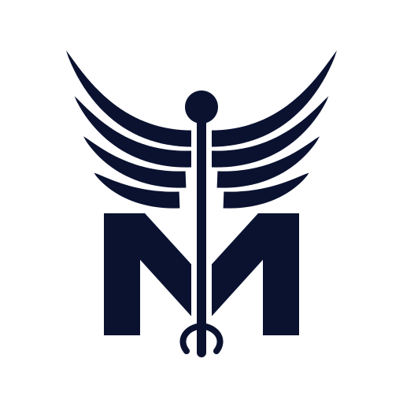

<div align="center">

<picture>
  <source media="(prefers-color-scheme: dark)" srcset="assets/bluehermes-mark.svg">
  
</picture>

<pre>
         ██████╗ ██╗     ██╗   ██╗███████╗         
         ██╔══██╗██║     ██║   ██║██╔════╝         
         ██████╔╝██║     ██║   ██║█████╗           
         ██╔══██╗██║     ██║   ██║██╔══╝           
         ██████╔╝███████╗╚██████╔╝███████╗         
         ╚═════╝ ╚══════╝ ╚═════╝ ╚══════╝         
                                                   
██╗  ██╗███████╗██████╗ ███╗   ███╗███████╗███████╗
██║  ██║██╔════╝██╔══██╗████╗ ████║██╔════╝██╔════╝
███████║█████╗  ██████╔╝██╔████╔██║█████╗  ███████╗
██╔══██║██╔══╝  ██╔══██╗██║╚██╔╝██║██╔══╝  ╚════██║
██║  ██║███████╗██║  ██║██║ ╚═╝ ██║███████╗███████║
╚═╝  ╚═╝╚══════╝╚═╝  ╚═╝╚═╝     ╚═╝╚══════╝╚══════╝
                                                   
  ~ python · machine learning · llm automation ~   
</pre>

<a href="https://github.com/BlueHermes">
  
</a>

<br/>

<a href="https://www.linkedin.com/in/morteza-mahdavi-414701354"></a>


</div>

---

## 👋 Hi, I'm BlueHermes

I'm a **Python specialist** focused on **machine learning** and **LLM-powered automation**.
By day I'm Board Member and Head of Technology Development at **Trita AI Engineering**,
where I lead the company's tech strategy and build its AI, ML and automation solutions.

I came to code from **human factors research**. In my M.Sc. in Ergonomics I modelled how
people behave under pressure with Bayesian networks and Petri nets. Today I build systems
where people and models work together.

I'm also a teacher at heart. I teach **Python and C++** at dplearn, and I've been teaching
**English (ESL) and IELTS preparation** to private students since 2020.

```python
class BlueHermes:
    """Python specialist · Machine Learning · LLM automation."""

    def __init__(self):
        self.name      = "Morteza Mahdavi"
        self.role      = "Head of Technology Development @ Trita AI Engineering"
        self.focus     = ["Machine Learning", "LLM-powered automation", "Data analysis"]
        self.daily     = ["Python", "n8n", "LLM APIs", "Docker", "Linux"]
        self.also      = {"C++": "solid, I teach it", "Web design": "I can ship it, not my forte"}
        self.teaching  = {"Python & C++": "dplearn", "ESL & IELTS": "private students since 2020"}
        self.languages = {"Persian": "native", "English": "fluent"}

    def mission(self) -> str:
        return "Carry messages between humans and machines, reliably."
```

## 🧰 Toolbox

**Core**


**Bots & infrastructure**


**Also in the bag**


```text
Python ............ ████████████████████  specialist
Machine Learning .. ████████████████░░░░  main focus
LLM Automation .... ████████████████░░░░  main focus
Statistics ........ ███████████████░░░░░
C++ ............... ████████████░░░░░░░░  solid, I teach it
English / IELTS ... ██████████████████░░  fluent, I teach it
Web design ........ ███████░░░░░░░░░░░░░  can ship it, not my forte
```

## 🛠️ What I build

- 🤖 **LLM automations**: n8n workflows wired to LLM APIs that take repetitive work off people's plates.
- 💬 **Python bots** for Telegram, Bale and Eitaa, including multi-user SaaS bots with payment flows.
- 📊 **ML and data analysis**: statistics, Bayesian networks and predictive models in Python.
- 🐳 **Self-hosted services** on Linux VPS, deployed and maintained with Docker.

## 👨‍🏫 What I teach

- 🐍 **Python & C++** at dplearn, from core fundamentals to object-oriented programming.
- 🗣️ **English (ESL) & IELTS preparation**: private tutoring since 2020, focused on IELTS exam preparation. Trained through the 40-hour IELTS Teacher Training Course at Shahid Beheshti University.

## 🚀 Experience

| Role | Where | When |
| :-- | :-- | :-- |
| **Board Member & Head of Technology Development** | Trita AI Engineering | Aug 2026 – now |
| **Programming Languages Instructor** (Python, C++) | dplearn | Nov 2025 – now |
| **Freelance Programmer**: bots, automation, self-hosting | Remote | 2024 – now |
| **ESL & IELTS Tutor** | Private students | 2020 – now |
| **Head of R&D** | Treata Ergonomics | 2021 – 2023 |
| **CEO & Founder** | Treata Ergonomics | 2019 – 2021 |

## 🎓 Education

- **M.Sc. in Ergonomics**, Tehran University of Medical Sciences (2020 – 2024). Ranked **1st** in the national master's entrance exam.
- **B.Sc. in Occupational Safety and Health**, Mazandaran University of Medical Sciences (2016 – 2020)

<details>
<summary><b>📚 Research: 4 journal articles · 1 book · 2 patents</b></summary>

<br/>

**Journal articles**

- **2027**: *Assessing human reliability and estimating evacuation time in hospital emergencies: A Bayesian network and Petri net approach.* Safety Science, 206, 107513. [doi:10.1016/j.ssci.2026.107513](https://doi.org/10.1016/j.ssci.2026.107513)
- **2025**: *The application of a systems thinking-based risk assessment method to identify hospital emergency evacuation risks.* Human Factors and Ergonomics in Manufacturing & Service Industries, 35(3). [doi:10.1002/hfm.70001](https://doi.org/10.1002/hfm.70001)
- **2021**: *Conceptual design of an ergonomic desk converter using anthropometric data of the Iranian community.* Iranian Journal of Ergonomics, 9(3), 104–120.
- **2018**: *Anthropometric engineering approach in conceptual design of sleeping pillow.* Occupational Medicine Quarterly Journal, 10(4), 74–82. [doi:10.18502/tkj.v10i4.1737](https://doi.org/10.18502/tkj.v10i4.1737)

**Book**

- **2020**: *Economy of Ergonomics and Safety* (co-author). Fadak Isatis · ISBN 978-600-160-396-9

**Patents** (Iran's Office of Industrial Property)

- Ergonomic sleeping pillow with adjustable height · Reg. No. 101915
- Ergonomic sit-stand saddle chair with posture-correction features · Reg. No. 103326

</details>

<details>
<summary><b>🏅 Certifications</b></summary>

<br/>

**Programming**, from Quera College

- Project-Oriented Course in Creating Telegram Bots Using Python (Aug 2026)
- Task-Oriented Course in n8n (Jan 2026): *perfect score*
- Task-Oriented Course in WordPress (Mar 2026): *perfect score*
- Advanced Python Programming & Object-Oriented Thinking: *perfect score*
- Task-Oriented Course in Fundamentals of Python Programming: *perfect score*
- Task-Oriented Course in C++ Programming: *perfect score*

**English teaching**

- IELTS Teacher Training Course (40 hours), Shahid Beheshti University, Institute of English Education
- English Language Course, Iran Language Institute

</details>

## 🎲 Off the keyboard

🔧 Building electronic gadgets · 🐉 Dungeons & Dragons game master · 🎸 Guitar · 🪵 Wood carving · ✍️ Reading and writing poetry · 📖 Novels, psychology and philosophy

---

<div align="center">

<pre>
   ~~~~&gt;  hermes.send(to="humans", via="machines")  &lt;~~~~
</pre>

<sub>Hermes carried messages between gods and mortals. I carry them between humans and machines.</sub>

</div>
